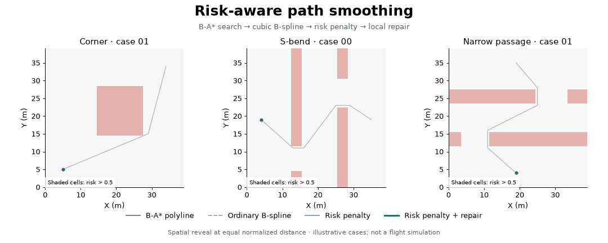
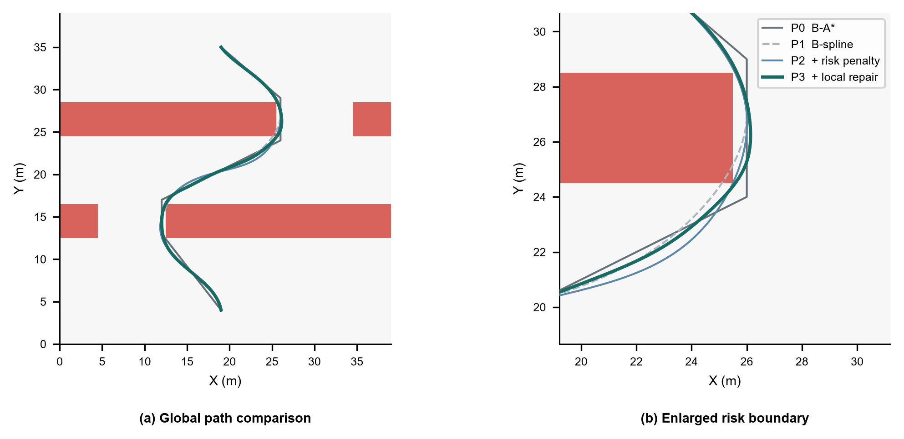
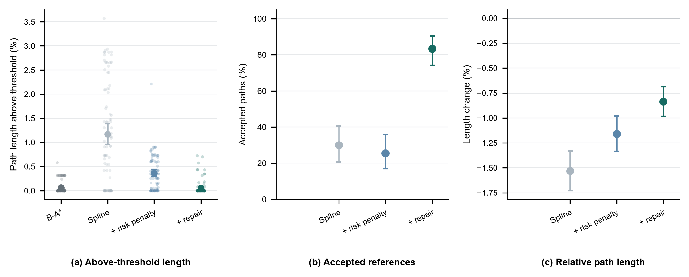

# Risk-aware Path Planning & Smoothing

**B-A* 路径规划 → 三次 B-spline 平滑 → 风险惩罚 → 局部修复 → 风险与运动学验收。**

面向四旋翼参考轨迹生成的独立实验代码。包含三类米级风险地图、四种方法、90 个配对任务以及可复现的展示动图。



灰色为 B-A* 折线，橙色为普通样条，蓝色为风险惩罚样条，绿色为进一步局部修复的样条；浅红区域为超过风险阈值的栅格。动图按各曲线相同的归一化弧长比例展开，展示最终几何形状，**不表示优化迭代或真实飞行时间**。每类选取编号最小的“P1 越界且 P3 通过”案例，具体编号和验收结果见 [选择记录](data/demo_selection.json)。

原实验的局部放大图可进一步观察切角与修复：



## 方法与实验

| 方法 | 处理 | 通过风险及运动学筛查 |
|---|---|---:|
| P0 | B-A* 折线，几何参照 | 不参与平滑参考通过率比较 |
| P1 | 普通三次 B-spline | 27 / 90（30.0%） |
| P2 | B-spline + 超阈值风险惩罚 | 23 / 90（25.6%） |
| P3 | 风险惩罚 + 违规附近控制点补入与有限重试 | 75 / 90（83.3%） |

三类场景：转角、S 弯、窄通道，各 30 个参数化任务；40 × 40 栅格，1 m/格。风险阈值 0.5，独立验收采样间距 0.005 m。参考同时约束速度 ≤ 2 m/s、切向加速度 ≤ 2 m/s²、横向加速度 ≤ 2.5 m/s²。125 条接受参考在 0.0025 m 加密复核中未发现新增越界。



数值来自完整 [逐任务记录](results_005/case_results.csv) 和 [汇总表](results_005/summary_by_method.csv)。P3 相比 P1 的通过率增加 53.3 个百分点，配对案例 bootstrap 95% 区间为 42.2–64.4 个百分点。P2 通过率低于 P1，表明本实现中单独加入局部风险惩罚并不能可靠消除切角。

## 快速运行

建议使用 Python 3.11，在本文件夹运行：

```bash
python -m venv .venv
# Windows PowerShell: .\.venv\Scripts\Activate.ps1
# macOS / Linux: source .venv/bin/activate
python -m pip install -r requirements.txt
python verify_package.py
python make_demo.py
```

`make_demo.py` 直接使用包内曲线重建 GIF、PNG、SVG 和 PDF，不运行控制器，不依赖 FFmpeg。`--prepare` 用冻结的地图种子与算法重新生成三类展示曲线。GIF 首次生成可能需要数十秒。

快速检验三类地图各一个任务（结果另存）：

```bash
python run_e1.py --n-per-scenario 1 --out results_local/smoke
```

重跑全部 90 个几何任务并独立加密验收：

```bash
python run_e1.py --out results_local/geometry
python check_resolution_e1.py --out results_local/geometry/resolution_check.csv
python plot_e1.py --data results_local/geometry
```

可选闭环控制验证（运行时间较长）：

```bash
python run_control_e1.py --out results_local/control
```

该入口会重新生成参考并执行合格参考，使用 17 状态 NMPC；全部失败与拒绝仍记入结果。已完成实验的 270 条控制尝试指标在 `results_005/control_results.csv` 中。完整逐时刻控制日志未包含在此轻量发布包。

## 文件组织

| 路径 | 内容 |
|---|---|
| `source/` | B-A*、样条、动力学和控制器快照 |
| `run_e1.py` | 场景生成、P0–P3 对照、风险与运动学验收 |
| `run_control_e1.py` | 可选闭环验证 |
| `data/` | 三类展示曲线与选择规则 |
| `assets/` | README 动图、静态预览和矢量图 |
| `results_005/` | 完整实验指标和原实验图表 |
| `docs/` | 原实验说明与解释范围 |
| `snapshot_manifest.json` | 打包时的实验文件 SHA256 |

## 解释范围

当前证据来自三类合成模板的开发批次，并非广泛实际地图的独立验证；离散加密检查也不是连续风险约束的数学证明。风险约束指地图风险阈值，不自动等同于实体障碍碰撞认证。P3 采用违规附近节点补入及有限重试。

闭环数据来自理想模型下的离线仿真，125 条被接受参考被执行，145 条被拒绝。约 55.7% 求解步超过 50 ms，不能据此宣称已实现实时飞行；不同方法的闭环 RMSE 来自各自接受的参考子集。此路径实验不混入 IMM、OV 或冲突重规划。

---

**English:** A standalone risk-aware B-A* and cubic B-spline benchmark with posterior checking and local repair. The GIF reveals final spatial curves at equal normalized arc length. All 90 paired geometric tasks remain in the supplied CSV files; the animation is an illustrative subset. Results support the stated synthetic-map development benchmark only.
